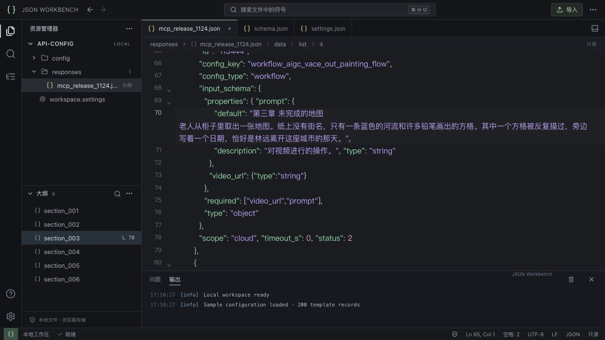

# 摸鱼阅读器（Moyu Reader）

把书藏进代码里的本地阅读器。支持 TXT、EPUB 和文字版 PDF，以代码编辑器和 JSON 的形式展示原文。



## 第一次安装和启动

先安装 [Node.js](https://nodejs.org/en/download) 的 LTS 版本，装好后重新打开终端。

下载或复制项目后，在项目文件夹里打开终端，执行：

```sh
npm install
npm run dev
```

在浏览器打开终端显示的地址，通常是 **http://127.0.0.1:5173/**。

使用时不要关闭这个终端。用完后，在终端按 **Ctrl + C** 停止。

## 以后怎么启动

在项目文件夹里执行这一句即可，不用重复安装：

```sh
npm run dev
```

**macOS 也可以双击 `启动工作台.command`**，它会启动服务并自动打开浏览器。第一次运行会自动安装依赖，仍需先装好 Node.js。

## 怎么使用

1. **导入书籍**：点右上角「导入」，选择 TXT、EPUB 或 PDF，也可以直接把文件拖进页面。PDF 需要能选中文字，扫描图片版不支持直接读取。
2. **阅读**：按 **Z** 向下跳到下一条 `default` 正文，按 **E** 向上跳到上一条，都把正文的第一行贴到编辑区顶部，自动跳过配置。同一条正文换成多行显示，也只跳一次。两个方向都停在当前章节内。也可以滚动阅读，或按 **Alt + ↓ / ↑** 跳到本章下一段、上一段。
3. **切换章节**：点左侧大纲，或用顶部搜索按章节名称、编号跳转。每章独立，滚到末尾不会自动进入下一章。
4. **调整设置**：点左下角齿轮，可以改字号、正文出现频率和章节标题显示。「向下跳转键」「向上跳转键」可以分别修改：点击按键框，再按一个字母、数字或空格即可，两个方向不能用同一个键。设置自动保存，也能分别恢复 Z、E。搜索或输入时不会触发正文跳转。
5. **切到纯配置区域**：按 **F8**，再按一次回到刚才的位置。也可以点底部的盾牌图标。

工作区显示的是 `.json` 别名。想看真实书名、改别名或移除书籍，到「导入」窗口操作。

## 下次还能接着看吗？

可以，书籍、阅读位置和设置会自动保存在当前浏览器里。下次启动后，用**同一个浏览器、同一个地址和端口**打开即可恢复。

文件只在本机处理，不会上传。不同浏览器之间不会同步；清除网站数据会删除保存的书籍和进度。

## 常用快捷键

Mac 用 `Cmd`，Windows / Linux 用 `Ctrl`。

| 快捷键 | 功能 |
| --- | --- |
| Z（可在设置中修改） | 下一条正文的第一行贴齐顶部；到章末停止 |
| E（可在设置中修改） | 上一条正文的第一行贴齐顶部；到章首停止 |
| Cmd / Ctrl + O | 导入文件 |
| Cmd / Ctrl + Shift + O | 搜索章节 |
| Alt + ↓ / ↑ | 本章下一段 / 上一段 |
| F8 | 切到纯配置区域 / 返回 |
| Cmd / Ctrl + B | 隐藏 / 显示左侧栏 |

如果提示找不到 `npm`，先安装 Node.js，再重新打开终端。页面打不开时，检查启动终端是否还在运行，并以终端显示的地址为准。
